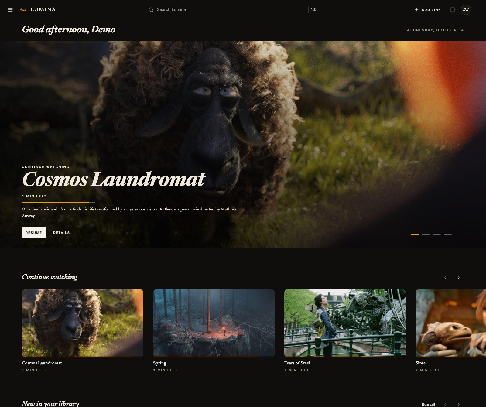
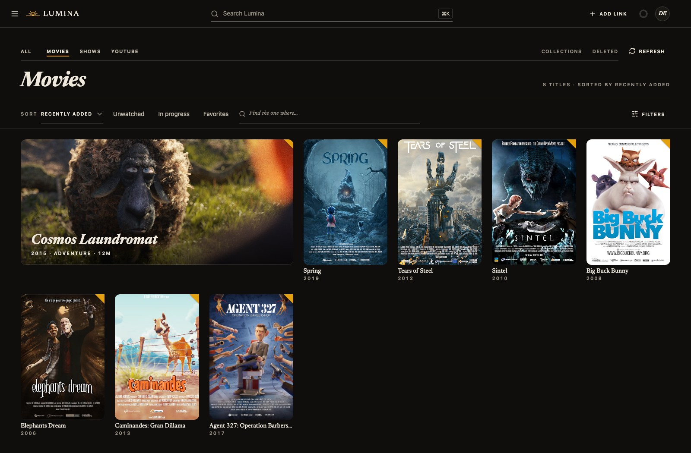

<p align="center">
  
</p>

<h1 align="center">Lumina</h1>

<p align="center">
  <a href="https://luminamedia.app/"><b>luminamedia.app</b></a> ·
  <a href="https://luminamedia.app/docs/">Documentation</a>
</p>

<p align="center">
  <b>Your household's own streaming service.</b><br>
  Stream and save from YouTube and Twitch, then watch it next to your movies, TV and music,<br>
  in the browser or compatible Jellyfin apps.
</p>

<p align="center">
  <a href="https://github.com/shiftedx/lumina/releases/latest"></a>
  <a href="LICENSE"></a>
  
  
</p>

<p align="center">
  <a href="#run">Install</a> ·
  <a href="docker/README.md">Operator guide</a> ·
  <a href="RELEASE_NOTES.md">Release notes</a> ·
  <a href="CONTRIBUTING.md">Contributing</a>
</p>

<p align="center">
  
</p>

<table>
  <tr>
    <td width="50%"><b>One search</b><br>YouTube, the channels you follow and your own library in one box. Watch now, save with one click.</td>
    <td width="50%"><b>Live</b><br>YouTube and Twitch live streams with chat, and chat replay for finished broadcasts.</td>
  </tr>
  <tr>
    <td><b>Your library</b><br>Movies, TV, music and downloads with TMDB artwork and a full metadata editor. Read-only folder imports, optional scheduled scans and folder watching, and a visible Refresh action. Library-wide discovery and indexing progress appear in the header activity indicator.</td>
    <td><b>Any screen</b><br>Infuse and other Jellyfin apps connect directly. Direct play, remux or transcode, with Intel QSV/VAAPI.</td>
  </tr>
  <tr>
    <td><b>The whole household</b><br>Members, invitations, per-member limits, two-step verification, and requests through Sonarr and Radarr. A visual welcome guides new members into interests, creators, and their own Home.</td>
    <td><b>Private by default</b><br>Loopback-only until you open it up. Recommendations run locally; AI transcripts and summaries are optional and can run on-device.</td>
  </tr>
</table>

<p align="center">
  
</p>

## In 0.4.0

- YouTube: opt-in personal sessions; encrypted per-user credentials; disconnect revocation; restricted-video fallback.
- Playback: paused-music activity cleanup; Up next preparation; protected-stream handoff; persistent player dismissal.
- Music: shared queues; listening export; artist/album identity; artwork recovery; responsive lyrics; floating mini player.
- Integrations: Sonarr/Radarr inventory and acquisition controls; Lidarr requests; collected-data views; Chromecast handoff.
- Library: bounded discovery and artwork I/O; accurate scan progress; faster Books/manga loading and page turns.
- Interface: compact settings workspaces; branded dropdowns; square gold switches; subject-aware hero framing and motion.
- Server: household/member resource budgets; GitHub release checks; owner update notifications.

See the [release notes](RELEASE_NOTES.md) for changes and upgrade details.

## Run

Needs Docker with Compose, on amd64 or arm64. Lumina 0.4.0 uses the pinned multi-platform image `ghcr.io/shiftedx/lumina:0.4.0`.

```bash
mkdir lumina && cd lumina
curl -fsSLO https://github.com/shiftedx/lumina/releases/download/v0.4.0/docker-compose.yml
curl -fsSLO https://github.com/shiftedx/lumina/releases/download/v0.4.0/SHA256SUMS
grep 'docker-compose.yml$' SHA256SUMS | shasum -a 256 -c -
printf 'LUMINA_RUNTIME_UID=%s\nLUMINA_RUNTIME_GID=%s\n' "$(id -u)" "$(id -g)" > .env
docker compose pull lumina
docker compose up -d --no-build lumina
```

Open <http://127.0.0.1:8765> and create the first admin. Both native amd64 and arm64 release images pass container smoke checks before publication. The release also includes [image digests and source revision](https://github.com/shiftedx/lumina/releases/download/v0.4.0/release-image.json). The [operator guide](docker/README.md) covers backups, upgrades, release-tag checkouts and source builds.

| To | See |
| --- | --- |
| Configure, add media folders, back up, upgrade | [Operator guide](docker/README.md) |
| Reach it from other devices | [Remote HTTPS](docker/README.md#remote-https) · [LAN HTTP mode](docker/README.md#lan-http-mode) |
| Use hardware transcoding | [Intel QSV/VAAPI](docker/README.md#hardware-transcoding-intel-qsvvaapi) |
| Connect Infuse or another Jellyfin app | [Jellyfin apps](docker/README.md#jellyfin-apps-infuse-swiftfin) |
| Report a vulnerability | [Security policy](SECURITY.md) |

## Develop

Toolchain versions are pinned in `.tool-versions` (install them with [mise](https://mise.jdx.dev)).

The Git history restarts at 0.3.0. Use a fresh clone when moving from a checkout of the previous history.

```bash
mise install
mise exec -- make bootstrap   # backend venv + frontend deps
./scripts/run-dev.sh          # backend :8765, UI :5173
mise exec -- make check       # full test gate, required before a PR
```

FastAPI and SQLite in `backend/`, React, TypeScript and Vite in `frontend/`. Architecture decisions live in [`docs/adr/`](docs/adr/). Start with [CONTRIBUTING.md](CONTRIBUTING.md), or [AGENTS.md](AGENTS.md) for coding agents.

## Scope

Lumina uses public sources by default. Members can optionally connect an encrypted personal YouTube session for recorded-video playback. Downloads and discovery remain anonymous; DRM is unsupported. You are responsible for following the terms of the sites you use.

## Credits

Lumina stands on [yt-dlp](https://github.com/yt-dlp/yt-dlp), [FFmpeg](https://ffmpeg.org) (via [jellyfin-ffmpeg](https://github.com/jellyfin/jellyfin-ffmpeg)), [llama.cpp](https://github.com/ggml-org/llama.cpp) and [faster-whisper](https://github.com/SYSTRAN/faster-whisper), with metadata from [TMDB](https://www.themoviedb.org) and [AniList](https://anilist.co). Full list and licenses: [CREDITS.md](CREDITS.md). This product uses the TMDB API but is not endorsed or certified by TMDB. Lumina is not affiliated with Jellyfin, YouTube, Twitch or any other project or service it works with.

Screenshots show Blender Studio open movies in the 0.3.4 interface. Film stills and posters are credited in [CREDITS.md](CREDITS.md#readme-screenshots).

## License

[AGPL-3.0-or-later](LICENSE)
