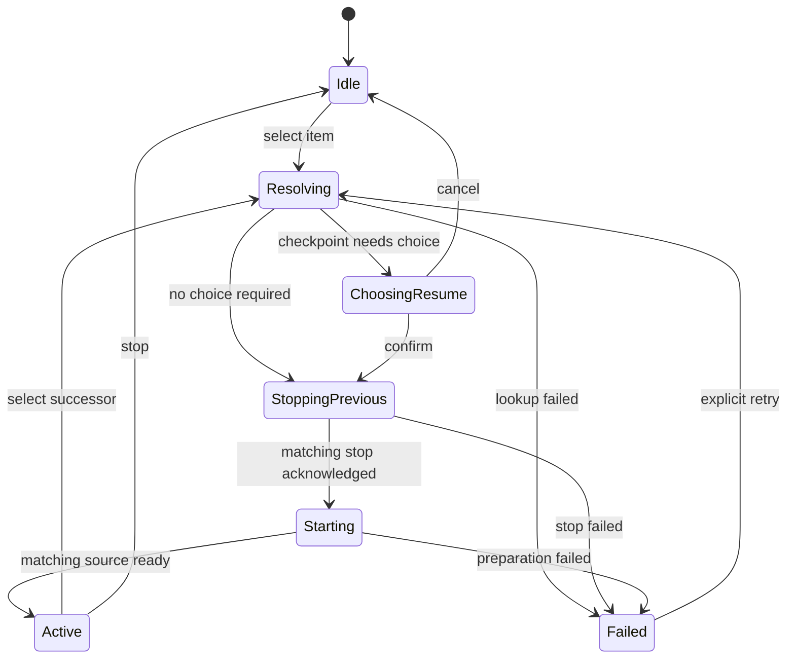

# Plan for explicit state machines in Lumina

Date: 2026-11-07. Source baseline: `dc9f94c9`. Scope: the FastAPI backend, React web app, and native iOS/tvOS app in this repository.

Lumina's most valuable opportunities are playback ownership, music synchronization, settings persistence, and durable work recovery. These workflows encode phases in combinations of booleans, nullable values, task handles, timestamps, and generation counters. Naming the states alone will not fix that: each workflow needs one owner for its transitions, including cancellation, stale completion, retry, and cleanup.

Use small local reducers, Swift enums with associated values, and Python transition functions inside the existing modules. Preserve the existing outbox, transaction, revision, and ownership contracts. An app-wide state-machine framework or a universal job lifecycle would add complexity without resolving those contracts.

## Scope and reading guide

This is a static source inventory of app-owned lifecycle families, including machines that are already partly explicit. It groups repeated instances, such as paginated fetches and edit/save forms, rather than counting every spinner as a separate machine. The proposed states below describe the intended design; they are not assertions that all those names exist in the current implementation. Arrows show representative paths, not complete transition tables.

The inventory contains 64 families: 36 backend, 18 web, and 10 native. They overlap deliberately where a client and server own different parts of one user workflow. Those parts should communicate through existing interfaces, not share one mutable state object.

Classification:

- **Implicit**: lifecycle is inferred from independent fields, collections, handles, or timestamps.
- **Partial**: states have names, but transition ownership or lifecycle context is spread across call sites.
- **Explicit**: a useful existing transition owner; preserve and extend its contract instead of replacing it.

Priority means implementation order, not a confirmed defect: **P1** protects ownership, persistence, external side effects, or resource cleanup; **P2** improves workflow consistency; **P3** is a local cleanup when the module is next changed. No listed risk is, by itself, a reproduced bug.

## Implemented priorities

The first two recommended changes were implemented on 2026-11-07:

- **W03 watch-start ownership:** [LuminaApp.tsx](../../frontend/src/LuminaApp.tsx) now owns resolution, resume choice, predecessor stop, startup, active and failed phases under one intent/session identity. Resume payload and startup loading derive from that state. Leaving cancels pending starts; an active mini-player stays mounted. Reselecting an active item cancels a pending successor. [LuminaKeyboard.test.tsx](../../frontend/src/LuminaKeyboard.test.tsx) covers navigation before item/history completion, reversed A/B responses, and active A → pending B → A, alongside the existing resume/member-change contracts. The new [browser regression](../../frontend/e2e/watch-start.spec.ts) reproduced the late-navigation takeover before the fix and passes afterward.
- **W12 personal-preference autosave:** [workspace.ts](../../frontend/src/workspace.ts) now owns idle/debouncing/writing/awaiting-baseline phases. Writes serialize and acknowledge only their own revisions; edits and reverts made during a write remain pending. Per-key edit ownership preserves unrelated settings received through SSE. Session reset/reload invalidates obsolete work. [workspaceAutosave.test.tsx](../../frontend/src/workspaceAutosave.test.tsx) covers in-flight revert, failure followed by a different-key edit, member replacement, same-member reload, and external snapshot preservation. Manual settings forms remain a later W12 slice.

Focused validation passed: 104 watch workflow tests, 80 workspace/autosave tests, frontend type checking, and all four mocked watch-start browser journeys. Continue with the remaining sequence below based on observed risk; these changes do not require a new dependency, schema, or wire contract.

In W03, `active` means the authorized selection has been handed to the existing player/source owners after its starting position is known. It does not assert that media has decoded or begun playing; W04–W06 still own transport and source readiness. In W12, failed drafts remain local and are retried with a later edit, preserving the existing retry policy.

Final integration validation against upstream `main` (`2ea48c02`) passed with the generated M2TS corpus configured: `mise exec -- make check` completed bootstrap checks, browser-tier driver checks, frontend type checking, production build/bundle budgets, 5,909 backend tests (20 expected prerequisite skips), 2,849 frontend tests, and all 776 browser cases. The browser tier included real-backend journeys, performance budgets, and WebKit decode checks. The realstack notes journey now waits for the final title layout before its initial Play interaction; it also passed an isolated run, five repeats, and the focused Watch suite. `git diff --check` and local document-link checks passed.

## Backend inventory

Paths in this section are relative to `backend/app/`. Existing status strings remain the wire/storage representation unless a separate compatibility change is justified.

| ID | Lifecycle and evidence | Current form | Proposed explicit owner and invariant | Priority |
| --- | --- | --- | --- | --- |
| B01 | Acquisition entry, source reservation, job-output link, and batch aggregate: [acquisition_batch.py](../../backend/app/services/acquisition_batch.py), [acquisition_job_manager.py](../../backend/app/services/acquisition_job_manager.py), `AcquisitionBatchService` | Partial, with strong durable claims | Keep the entry as the outbox owner. Define events for reservation, dispatch receipt, uncertain dispatch, job completion, explicit retry. Reservation and entry have separate lifecycles; batch status is a projection. A staged job cannot enqueue before its output link commits. | P1 |
| B02 | Download execution and attempts: [job_manager.py](../../backend/app/services/job_manager.py), `JobManager`, `DownloadJob` | Partial | Make staged/queued/running/postprocessing/terminal transitions and restart interruption explicit in the manager. Attempt identity guards progress and completion. Cancellation of a queued job must prevent execution; late progress cannot revive terminal work. | P1 |
| B03 | Scheduled/live recording, sibling media/chat outputs, stop and restart: [live_recording.py](../../backend/app/services/live_recording.py), [live_recording_manager.py](../../backend/app/services/live_recording_manager.py), [live_recording_waiter.py](../../backend/app/services/live_recording_waiter.py) | Explicit durable core; runtime coordination is partial | Retain `LiveRecordingService`, `compute_overall_status`, and `plan_recovery`. Make waiter/capture/finalizer runtime ownership explicit around it. Preserve independent media/chat outcomes, waiting limits, from-start choice, and the difference between stop, cancel, and source end. | P1 |
| B04 | Timed-chat asset build, replacement, and partial outcome: [timed_chat_asset.py](../../backend/app/services/timed_chat_asset.py), `ChatReplayAsset` | Partial | Own begin/publish/fail/replace under the build ID and source identity. A superseded builder cannot overwrite a newer asset. Keep asset lifecycle separate from recording lifecycle. | P2 |
| B05 | Media request approval, dispatch, progress, availability, retry: [requests/engine.py](../../backend/app/services/requests/engine.py), [requests/sync.py](../../backend/app/services/requests/sync.py), [requests/status.py](../../backend/app/services/requests/status.py) | Partial, named `STATES` | Centralize legal request events and guards in the existing request module. Keep approval state, upstream progress, and member-visible registered availability distinct. Include season expansion, decline/cancel authorization, and retry semantics. | P1 |
| B06 | External Arr mutation and uncertain result: [arr_operations.py](../../backend/app/services/arr_operations.py), `_admit`, `_mark_dispatching`, `_finish`, `reconcile` | Partial, durable operation ID | Define pending/dispatching/uncertain/terminal transitions with operation ID and connection signature. An ambiguous external result must reconcile rather than blindly resend a non-idempotent mutation. | P1 |
| B07 | Arr observation freshness and registration reconciliation: [arr_observer.py](../../backend/app/services/arr_observer.py), `ArrObservationState`, `ArrObservedItem.import_state` | Implicit/partial | Separate snapshot refresh state from per-item import state. Use connection identity and observation generation to publish a complete snapshot; retain last good data on refresh failure. Observation alone must never establish playability. | P2 |
| B08 | Music acquisition approval, Lidarr dispatch, uncertain result, import: [lidarr.py](../../backend/app/services/lidarr.py), [music_queue_entries.py](../../backend/app/services/music_queue_entries.py) | Partial | Keep durable acquisition owner in Lidarr module with approval/dispatch/reconcile/import events. Queue entry availability is a projection of visible registered tracks, not command completion. Preserve release-group identity. | P1 |
| B09 | Member-owned listening queue, revision conflict, active output: [music_listening_session.py](../../backend/app/services/music_listening_session.py) | Partial, strong revision seam | Make queue edit, canonical restore, receiver activation, and receiver release named commands with expected revision/output ticket. Keep queue availability separate from playback. Stale writes and old ticket cleanup cannot seize the current output. | P1 |
| B10 | Listening export account authorization, play eligibility, provider delivery: [listening_export.py](../../backend/app/services/listening_export.py) | Partial, per-provider JSON statuses | Model account authorization separately from each delivery: ineligible/pending/dispatching/sent/uncertain/revoked and existing failure outcomes. All results carry account generation. Ambiguous sends require provider-aware reconciliation; seeking is not elapsed listening. | P1 |
| B11 | Library scan, cancellation, resumption, missing-file confirmation: [library_import.py](../../backend/app/services/library_import.py), `ImportRun` | Partial, named active/resumable sets | Keep run state and indexing/discovery phase distinct. Centralize start/cancel/checkpoint/confirm/resume/interruption. Cursor and imported rows commit together; incomplete or offline scans cannot establish absence. | P1 |
| B12 | Library automation scheduling, probes, directory watch baseline/dirty work: [library_automation.py](../../backend/app/services/library_automation.py), [library_watch.py](../../backend/app/services/library_watch.py) | Partial, multiple runtime records | Separate probe lifecycle, scheduler eligibility, and watcher baseline/dirty/commit lifecycle. Express hung probe, confirmation hold, full scan, retry delay, and watch-size ceiling explicitly. Commit dirty-directory coverage only after a successful matching scan. | P1 |
| B13 | Source automation due/leased/running/deferred/released and preview: [source_automation.py](../../backend/app/services/source_automation.py), `SourceAutomation.run_lease_id`, `AutomationRun` | Partial | Lease owner and run outcome remain separate. Claim/renew/finish/recover must compare lease ID. Preview never acquires real downloads; deferred runs remain distinguishable from failed runs and may become eligible later. | P1 |
| B14 | Storage health, registered artifact availability, quarantine/restore/purge: [storage_roots.py](../../backend/app/services/storage_roots.py), [media_artifacts.py](../../backend/app/services/media_artifacts.py), [artifact_quarantine.py](../../backend/app/services/artifact_quarantine.py), [library_retention.py](../../backend/app/services/library_retention.py) | Implicit/partial | Keep observed root health separate from artifact lifecycle and member visibility. Name detach/quarantine/move/restore/purge operations and their post-commit reconciliation. Offline storage must not imply deletion; shared references must protect bytes. | P1 |
| B15 | ASR, captions, summaries, idea graphs, recaps and cancellation/recovery: [local_ai.py](../../backend/app/services/local_ai.py), `JobRegistry`, [enrichment.py](../../backend/app/services/enrichment.py), [summaries.py](../../backend/app/services/summaries.py), [idea_graph.py](../../backend/app/services/idea_graph.py), [recaps.py](../../backend/app/services/recaps.py) | Partial; shared registry already exists | Strengthen the existing registry's transition interface and use it across its existing callers. Keep job-kind output validation, input revision, and result invalidation local. Include pending/admitted/queued/running/canceling/terminal and restart interruption as applicable to each kind; do not force identical cancellation into all kinds. | P1 |
| B16 | Model bytes download/resume/verify/publish/remove: [model_downloads.py](../../backend/app/services/model_downloads.py), `DownloadManager`, `.wanted`/`.ready` markers | Partial, typed `State` | Add explicit stop intent: keep partials on shutdown versus discard on cancel/remove. Verification and publication belong to one generation. No ready marker before every catalog file verifies. | P1 |
| B17 | Local model subprocess starting/readiness/leases/idle stop/crash circuit: [model_supervisor.py](../../backend/app/services/model_supervisor.py), `Supervisor`, `_Server` | Implicit | Replace the inferred combination of `_servers`, `_failed`, `_refused`, process readiness, and `closed` with per-model runtime phases and a supervisor lifecycle. Keep lease count orthogonal. Startup completion cannot resurrect a closed supervisor; blocked models restart only under current retry policy. | P1 |
| B18 | Foreground/background admission, fair AI dispatch, pause/resume, shutdown: [background_work.py](../../backend/app/services/background_work.py), [ai_resources.py](../../backend/app/services/ai_resources.py), [upload_admission.py](../../backend/app/services/upload_admission.py), [playback_resources.py](../../backend/app/services/playback_resources.py) | Implicit/partial | Keep separate registries for separate resources. Name reservation/active/released ownership and registered/running/paused/reaped child transitions. Release is idempotent and token checked; no new work after close. Preserve existing fairness, caps, and foreground promotion. | P1 |
| B19 | Local HLS session and replaceable ffmpeg run: [local_playback_sessions.py](../../backend/app/services/local_playback_sessions.py), `PlaybackSession` | Implicit, process/registry/throttled fields | Distinguish session lifecycle from child-run lifecycle. Define starting/serving/closing/closed/failed for a session and running/throttled/exited for its run. Seek replaces the run, not its logical identity. An old reap cannot release its successor's allocation. | P1 |
| B20 | Remote resolution, HLS relay generations, live end, prefetch, stream-cache publication: [remote_streaming.py](../../backend/app/services/remote_streaming.py), [hls_relay.py](../../backend/app/services/hls_relay.py), [live_hls_relay.py](../../backend/app/services/live_hls_relay.py), [remote_prefetch.py](../../backend/app/services/remote_prefetch.py), [stream_cache.py](../../backend/app/services/stream_cache.py) | Implicit/partial | Keep descriptor, relay, prefetch request, and range writer as separate owners. Model resolve/refresh/expire, generation retirement, and staging/commit/abort respectively. Partial/aborted responses cannot publish complete cache entries; credentials and guarded transport remain attached to the correct generation. | P1 |
| B21 | Metadata refresh leases, provider cache freshness, artwork and hero-framing warmup: [title_metadata.py](../../backend/app/services/title_metadata.py), [omdb_ratings.py](../../backend/app/services/omdb_ratings.py), [title_images.py](../../backend/app/services/title_images.py), [hero_framing.py](../../backend/app/services/hero_framing.py), [artwork.py](../../backend/app/services/artwork.py) | Implicit/partial | Use per-key freshness plus idle/claimed/running/backoff/result lifecycle where work exists. Guard publication by lease/input identity. Preserve pending/ready/unavailable framing and foreground priority; failure must not erase protected source values or successful cached data. | P2 |
| B22 | Photo source scan, prepared products, cancellation and absent-file sweep: [photo_imports.py](../../backend/app/services/photo_imports.py), `PhotoImportSource`, `PhotoImportRun` | Partial | Run owns queued/running/canceling/terminal and source owns schedule/health. Prepared products are staged until a current-source commit accepts them. Cancel/incomplete scans do not mark unseen originals missing; abandoned preparation releases resources. | P1 |
| B23 | Face analysis queue/process/circuit, preview reservation/publication, index generations: [photo_faces.py](../../backend/app/services/photo_faces.py), [photo_cache.py](../../backend/app/services/photo_cache.py), [photo_derivatives.py](../../backend/app/services/photo_derivatives.py), [photo_face_index.py](../../backend/app/services/photo_face_index.py) | Implicit/partial | Separate job lifecycle, bounded child lifecycle, reservation lifecycle, and index publication. Source hash, pipeline signature, owner, and reservation token guard results. Disabling face analysis or deleting owner data invalidates in-flight results; no partial preview set or index generation becomes current. | P1 |
| B24 | Book reading status, canonical bundle membership, trash/restore: [books.py](../../backend/app/services/books.py), `BookItem`, `BookState` | Implicit derived status and lifecycle | Keep reading progress, bundle membership, and trash status independent. Give read/reset/complete and combine/separate/trash/restore named transitions. Retain format-aware position and completion rules, canonical shelf transfer, and reversible trash behavior. | P2 |
| B25 | Account active/disabled, session expiry, password reset, connected credentials: [users.py](../../backend/app/services/users.py), [connected_apps.py](../../backend/app/services/connected_apps.py), [security.py](../../backend/app/security.py), `AppSession`, `AccountToken` | Implicit, timestamps and credential digests | Centralize validity predicates and named issue/consume/revoke/disable events in the owning modules. Preserve credential-change invalidation and one-time token consumption. Do not persist a duplicate status that can disagree with expiry timestamps. | P1 |
| B26 | OAuth attempt, callback, identity link and rejection: [oauth.py](../../backend/app/services/oauth.py), [routers/oauth.py](../../backend/app/routers/oauth.py) | Implicit, bounded attempt map and destructive consume | Name attempt outcomes and callback result variants; retain consume-once semantics, browser binding, provider fingerprint, and expiry. Linking and sign-in have different authorization guards. | P1 |
| B27 | Two-factor setup/confirmation, lockout, challenges, recovery/trusted device: [two_factor.py](../../backend/app/services/two_factor.py) | Implicit/partial | Separate enrollment, challenge, and lockout policies. Use derived tagged states over current secrets/timestamps with explicit confirm/fail/consume/recover commands. Preserve replay protection, atomic recovery-code consumption, and owner setup requirements. | P1 |
| B28 | Invite, mobile connect, TV approval and claim: [invites.py](../../backend/app/services/invites.py), [routers/mobile_connect.py](../../backend/app/routers/mobile_connect.py), [routers/device_pairing.py](../../backend/app/routers/device_pairing.py) | Implicit derived statuses; TV has named results | Separate token validity from client polling. Define precedence for pending/approved/claimed/denied/expired/revoked as applicable to each protocol. Concurrent claims issue credentials once; issuer/target credential changes invalidate the correct enrollment. | P1 |
| B29 | Personal YouTube session and listening-provider authorization: [youtube_session.py](../../backend/app/services/youtube_session.py), [listening_export.py](../../backend/app/services/listening_export.py), [routers/listening_export.py](../../backend/app/routers/listening_export.py) | Partial, derived status/generations | Keep disconnected/authorizing/connected/reconnect-required/revoked local to each integration. Generation-bound failure handling must not invalidate a replacement account or cookie set. Personal YouTube credentials remain playback-only. | P2 |
| B30 | Backup creation/restore and audio writeback/rollback: [backups.py](../../backend/app/services/backups.py), [restore.py](../../backend/app/restore.py), [music_writeback.py](../../backend/app/services/music_writeback.py) | Implicit ordered filesystem protocols | Document and name validate/stage/verify/publish/cleanup/rollback phases in the existing implementations. These may remain synchronous command protocols rather than stored enums. Preserve recovery generations, source fingerprints, backup journals, and atomic replacement; do not imply a transaction spans DB and filesystem. | P1 |
| B31 | Provider budget refill/backoff, request rate limits, authentication lockout: [provider_budget.py](../../backend/app/services/provider_budget.py), [rate_limit.py](../../backend/app/services/rate_limit.py), [users.py](../../backend/app/services/users.py) | Implicit clock-derived policy | Expose allowed/deferred/blocked decisions with next-eligible time and explicit spend/fail/reset events. Keep bucket arithmetic and lock timestamps authoritative. Use injected clocks; no redundant stored `blocked` boolean. | P3 |
| B32 | Watched/resume/completed/reset, playback reports, screen-time heartbeat and access cutoff: [playback.py](../../backend/app/services/playback.py), [remote_playback.py](../../backend/app/services/remote_playback.py), [screen_time.py](../../backend/app/services/screen_time.py), [playback_log.py](../../backend/app/services/playback_log.py) | Implicit/partial progress and clock-derived states | Keep durable watch progress separate from actual listening time and screen-time enforcement. Name checkpoint/finish/restart/markPlayed/clear and heartbeat/stopped/policyChanged events. Preserve local credits-aware versus remote completion rules, per-member counting across devices, date rollover, and recommendation-event semantics. | P1 |
| B33 | Shared live-chat viewer bootstrap, continuation, end, expiry and member activity: [live_chat_viewer.py](../../backend/app/services/live_chat_viewer.py), [live_chat_seam.py](../../backend/app/services/live_chat_seam.py), [twitch_irc_chat.py](../../backend/app/services/twitch_irc_chat.py) | Partial active/ended/unavailable plus continuation and registry state | Separate provider source lifecycle from member viewer lease. Name bootstrap/poll/continuation/end/expire/dispose events with source and generation identity. Retain bounded dedupe and terminal-source behavior; an old poll cannot reopen an ended or replaced source. | P2 |
| B34 | Application startup recovery, worker start, serving, shutdown and child reaping: [main.py](../../backend/app/main.py), lifespan; participating managers | Implicit ordered startup/teardown protocol | Document dependency order and own starting/serving/closing/closed at lifespan. Recovery completes before ordinary work admission where required, especially acquisition link repair before job recovery. Failure during partial startup must close only initialized owners and reap owned children. Keep orchestration local rather than add a process framework. | P1 |
| B35 | Metadata source value, user override/pin/item lock, revert and upload attachment: [metadata_editor.py](../../backend/app/services/metadata_editor.py), [media_titles.py](../../backend/app/services/media_titles.py), [metadata_history.py](../../backend/app/services/metadata_history.py), [music_curation.py](../../backend/app/services/music_curation.py) | Implicit per-field provenance/override lifecycle | Keep source, override, pin and item lock as distinct dimensions. Name sourceRefresh/edit/pin/unpin/revert/identify/attach events through existing primitives and edit batches. Source refresh cannot overwrite protected values; reverting reveals the retained source instead of destroying provenance. | P2 |
| B36 | Release-check scheduling, running/cooldown/closed, retained result, owner notification: [release_updates.py](../../backend/app/services/release_updates.py) | Partial request-result literals plus runtime and durable timestamps | Separate scheduler/request lifecycle from latest-release comparison and notification attempt. Explicitly handle manual versus automatic cooldown, failure retention, shutdown and duplicate notification suppression. Checking a release never authorizes installing it. | P3 |

## Web inventory

Paths are relative to `frontend/src/`. Independent display preferences such as volume, captions, sort order, and a single open/closed menu are context or simple two-state controls; they do not need a reducer each.

| ID | Lifecycle and evidence | Current form | Proposed explicit owner and invariant | Priority |
| --- | --- | --- | --- | --- |
| W01 | Bootstrap, first owner, login, account links, OAuth callback, member switch, two-factor: [workspace.ts](../../frontend/src/workspace.ts), [LuminaApp.tsx](../../frontend/src/LuminaApp.tsx), [auth](../../frontend/src/features/auth/), [AccountPassword.tsx](../../frontend/src/AccountPassword.tsx) | Partial `AuthStage`, many app-local fields | One auth flow with restoring/setup/anonymous/authenticating/challenge/authenticated/switching/error variants. Session generation belongs to auth ownership. Hold old event streams before cookie changes and invalidate every old-member completion. | P1 |
| W02 | Owner vault setup, household transfer, member interests and discovery: [LuminaApp.tsx](../../frontend/src/LuminaApp.tsx), [onboarding](../../frontend/src/features/onboarding/), [member_onboarding.py](../../backend/app/services/member_onboarding.py) | Partial phase/stage enums plus busy/results fields | Separate owner setup, transfer, and member onboarding machines. Transfer states carry provider, selected members, processed results, and retry position. Persist only existing durable member completion; cancellation and reload have explicit outcomes. | P2 |
| W03 | Watch request, resume choice, stop predecessor, progress load, queued/autoplay start: [LuminaApp.tsx](../../frontend/src/LuminaApp.tsx), `resumeChoice`, `playbackLoading`, `watchStart`, [usePlaybackIntent.ts](../../frontend/src/features/gallery/usePlaybackIntent.ts) | Implicit | A watch-intent owner with idle/resolving/choosingResume/stoppingPrevious/starting/active/failed. Every event carries intent ID and auth epoch. Starting is permitted only after the predecessor stop and required choice; replacing an intent invalidates the old one. | P1 |
| W04 | HTML media transport, recovery, play/pause intent and ending: [LuminaPlayer.tsx](../../frontend/src/LuminaPlayer.tsx), [playIntent.ts](../../frontend/src/playIntent.ts) | Partial player state plus `isPlaying`, `ended`, `refreshing`, refs | Separate user intent from observed transport and recovery attempt. Derive playing/ended/loading/error UI from that state. A ready/playing event from a replaced media element cannot change the current source or clear its failure. | P1 |
| W05 | Remote descriptor resolution, source refresh, quality switch, HLS recovery: [remotePlayer.tsx](../../frontend/src/remotePlayer.tsx) | Implicit/partial | A remote-source owner carries descriptor and attempt through resolving/preparing/ready/refreshing/switching/unsupported/failed/disposed. Failed quality changes may retain the usable source. Authorization failure must not be treated as codec fallback. | P1 |
| W06 | Local probe, playback decision, direct/remux/transcode session, seek/replacement and admin stop: [localPlayer.tsx](../../frontend/src/localPlayer.tsx) | Implicit, many independent flags | A local-source owner carries item/options key, attempt, and session through probing/deciding/starting/ready/replacing/adminStopped/unavailable/failed/disposed. Dispose superseded sessions even if creation completes late; preserve old playable state during a recoverable change. | P1 |
| W07 | Music decoding/streaming, prefetch, gapless successor and crossfade: [musicEngine.ts](../../frontend/src/features/music/musicEngine.ts), [musicStream.ts](../../frontend/src/features/music/musicStream.ts) | Partial `MusicEngineState`, internal handles/generations | Keep existing controllers. Explicit current-track lifecycle and separate successor lifecycle; playing intent is context. Preserve queue occurrence identity, successor revision, decoded-memory budget, and one promotion per completed source. | P1 |
| W08 | Music owner, restore, dirty shared write, conflict, wait/skip acquisition, sleep: [musicSession.ts](../../frontend/src/features/music/musicSession.ts), [musicSharedSession.ts](../../frontend/src/features/music/musicSharedSession.ts) | Implicit module globals (`sharedDirty`, `sharedWrite`, `sharedQueued`, `adoptingShared`, `outputTransfer`) | Separate listening lifecycle from shared synchronization and sleep timer. Sync states include clean/dirty/writing/writingWithNewerEdits/conflicted/offline. Restore is paused; conflicts require explicit adoption or retry with the current revision. | P1 |
| W09 | Sonos/Chromecast handoff, ticket restore, polling, stop acknowledgement; AirPlay availability: [musicCastSession.ts](../../frontend/src/features/music/musicCastSession.ts), [ChromecastPanel.tsx](../../frontend/src/features/watch/ChromecastPanel.tsx), [chromecast.ts](../../frontend/src/features/watch/chromecast.ts), [AirPlayControl.tsx](../../frontend/src/features/watch/AirPlayControl.tsx) | Implicit/partial | Own local/transferring/remote/returning/uncertain states with output ticket and member identity. Local playback resumes only after required remote-stop acknowledgement. AirPlay capability observation remains separate from server-controlled receivers. | P1 |
| W10 | Lists/search/title cache, cursor append, stale data, refresh and offline: [workspace.ts](../../frontend/src/workspace.ts), `CollectionRequestGate`, [allStore.ts](../../frontend/src/features/gallery/allStore.ts), [titleCache.ts](../../frontend/src/features/gallery/titleCache.ts), [PhotosSurface.tsx](../../frontend/src/features/photos/PhotosSurface.tsx), [requests/parts.tsx](../../frontend/src/features/requests/parts.tsx) | Partial collection enums plus booleans/cursors | Extend the existing collection reducer/gate pattern first. Per-query snapshots distinguish initial load, refreshing retained data, append, append failure, stale/offline, empty and ready. Cursor commits require matching query/session generation. Share types only where semantics match. | P2 |
| W11 | SSE connection/coalescing, visibility-aware polling, job polling and reconnect refresh: [workspace.ts](../../frontend/src/workspace.ts), [usePolledSnapshot.ts](../../frontend/src/app/usePolledSnapshot.ts), [usePollJob.ts](../../frontend/src/features/watch/usePollJob.ts), [useLiveViewers.ts](../../frontend/src/features/watch/useLiveViewers.ts) | Implicit runtime flags; event coalescer already owns ordering | Make connection held/connecting/open/reconnecting/closed and poll idle/running/refreshQueued/settled/disposed explicit locally. Hidden-tab suspension is orthogonal. Retain terminal-event precedence and resolve queued refresh waiters on disposal. | P2 |
| W12 | Debounced personal settings and manual section/editor saves: [workspace.ts](../../frontend/src/workspace.ts), [SectionForm.tsx](../../frontend/src/features/settings/SectionForm.tsx), [unsavedChanges.ts](../../frontend/src/features/settings/unsavedChanges.ts), [aiForm.tsx](../../frontend/src/features/settings/sections/aiForm.tsx), [editor](../../frontend/src/features/titles/editor/) | Implicit timers, dirty/saving/status fields | Separate autosave from manual draft lifecycle. Track edit revision, sent revision, acknowledged snapshot, and auth epoch. A response acknowledges only the edits it sent; newer edits remain dirty. Preserve key-by-key preference patches and confirmed navigation discard. | P1 |
| W13 | Route selection, settings return, overlays, fullscreen/theater/mini-player hosting: [LuminaApp.tsx](../../frontend/src/LuminaApp.tsx), [routes.ts](../../frontend/src/app/routes.ts), [theaterMode.tsx](../../frontend/src/theaterMode.tsx), [fullscreenHost.tsx](../../frontend/src/fullscreenHost.tsx) | Route union exists; selected route fields are duplicated | Use the existing route union as navigation authority; derive surface-specific selections. Keep player presentation separate from transport and use mutually exclusive overlay variants where needed. Moving the host must not restart media; browser/system fullscreen events are authoritative. | P2 |
| W14 | Book manifest/chapter/prefetch/image load, reading and progress persistence: [BookReader.tsx](../../frontend/src/features/books/BookReader.tsx) | Implicit nullable payloads, load/save errors and flags | Split reader preparation from position-save lifecycle. Carry book/file/chapter identity in load states; ignore previous-chapter results. Save failure retains the reading location and can retry without reopening the book. | P2 |
| W15 | Live recording UI, schedule/from-start fallback choice, live chat versus replay/terminal source: [liveRecording.ts](../../frontend/src/liveRecording.ts), [liveRecordingControls.tsx](../../frontend/src/liveRecordingControls.tsx), [LiveChatPanel.tsx](../../frontend/src/features/watch/LiveChatPanel.tsx), [WatchChatSeam.tsx](../../frontend/src/features/watch/WatchChatSeam.tsx), [chatReplay.ts](../../frontend/src/chatReplay.ts) | Partial statuses with client pending/error flags | Client action state is separate from server recording state and chat source mode. Typed pending action/choice variants prevent a stop receipt from becoming a completed recording. Provider/live-source identity invalidates continuations and replay clocks. | P2 |
| W16 | Request sheets, import/backup dialogs, upload/offline progress, metadata/photo/book mutations, artwork loading: [RequestSheet.tsx](../../frontend/src/features/requests/RequestSheet.tsx), [admin](../../frontend/src/features/admin/), [BooksManagementDialogs.tsx](../../frontend/src/features/books/BooksManagementDialogs.tsx), [PhotoViewer.tsx](../../frontend/src/features/photos/PhotoViewer.tsx), [MusicPlayer.tsx](../../frontend/src/features/music/MusicPlayer.tsx), [Artwork.tsx](../../frontend/src/Artwork.tsx) | Repeated idle/busy/error/result and nullable dialog selections | Apply local operation variants only to multistep or cancellable work: editing/confirming/submitting/succeeded/failed/cancelled with target identity. Keep image source loading/loaded/fallback/failed keyed to source. Simple mutations can use a small tagged result without a reducer. | P3 |
| W17 | Source inspection, preview selection, per-source submission, related discovery, playlist batch retry: [mediaAcquisition.ts](../../frontend/src/mediaAcquisition.ts), `useMediaAcquisition`, [PlaylistAcquisition.tsx](../../frontend/src/features/downloads/PlaylistAcquisition.tsx) | Partial deep interface, independent flags and active-request maps | Retain the existing acquisition seam. Give preview/selection, related lookup, and each source submission their own tagged state; batch presentation projects durable entries. Different sources may queue concurrently, the same source may not. Format/inspection identity and session epoch guard preview reuse and stale results. | P1 |
| W18 | Local/remote checkpoints, mark/reset/restart, keepalive, autoplay once, episode presence deadline: [WatchSurface.tsx](../../frontend/src/features/watch/WatchSurface.tsx), [LuminaApp.tsx](../../frontend/src/LuminaApp.tsx), [playbackModel.ts](../../frontend/src/playbackModel.ts), [musicListeningExport.ts](../../frontend/src/features/music/musicListeningExport.ts) | Implicit request/interaction generations, serialized promises, suppression refs and episode-run record | Separate checkpoint persistence, listening-attempt sampling, and autoplay presence. Explicit checkpoint revision/suppression prevents a late save from undoing clear/restart. Autoplay has eligible/advancing/awaitingPresence/stopped outcomes and claims advancement once per completion; confirmation timeout must not start another episode. | P1 |

## Native inventory

Paths are relative to `apple/`. Swift state belongs on the existing actor/main-actor owner. These changes do not require making SwiftUI views run a second, parallel copy of the transport lifecycle.

| ID | Lifecycle and evidence | Current form | Proposed explicit owner and invariant | Priority |
| --- | --- | --- | --- | --- |
| N01 | Session restore/sign-in, mobile scan/deep link, TV pairing and claim: [LuminaStore.swift](../../apple/Core/Sources/LuminaCore/LuminaStore.swift), [MobileRootView.swift](../../apple/App/iOS/MobileRootView.swift), [TVRootView.swift](../../apple/App/tvOS/TVRootView.swift), [MobilePairScanner.swift](../../apple/App/iOS/MobilePairScanner.swift), [TVDevicePairing.swift](../../apple/Core/Sources/LuminaCore/TVDevicePairing.swift) | Partial pairing phase/status enums, optional session plus UI flags | Keep protocol status distinct from sign-in presentation. Associate handoff/request/origin/generation with pairing states. Restore, sign-out, regeneration and claim completion all compare the current session attempt; stale pairing cannot authenticate another server/member. | P1 |
| N02 | Home/library/music requests, navigation capability, connectivity and cache restore: [LuminaStore.swift](../../apple/Core/Sources/LuminaCore/LuminaStore.swift), [LuminaMusicLibrary.swift](../../apple/Core/Sources/LuminaCore/LuminaMusicLibrary.swift), [LuminaConnectivity.swift](../../apple/Core/Sources/LuminaCore/LuminaConnectivity.swift) | Partial navigation enum, busy flags/tasks/query generations | Per-query load states own retained data, page cursor, task identity and errors. Connectivity is a separate observation. Session changes invalidate all old queries and private cache publications; cancellation restores a defined retained snapshot. | P2 |
| N03 | Resume approval, native source preparation, fallback, seek, stream switch, ending: [PlaybackScreen.swift](../../apple/App/Shared/PlaybackScreen.swift), `PlaybackModel`, [NativeVideoSource.swift](../../apple/Core/Sources/LuminaCore/NativeVideoSource.swift), [NativeRemotePlayer.swift](../../apple/App/Shared/NativeRemotePlayer.swift) | Implicit/partial; seek authority already exists | Separate watch intent, transport, and source preparation/recovery. Use associated values for request/source/attempt and preserve `VideoSeekAuthority`. The latest source owns AVPlayer observers and conversion cleanup; recovery cannot undo a user pause or replace a newer selection. | P1 |
| N04 | Durable music restore, output transfer, conflict, waiting entry, background checkpoint: [NativeAudioSession.swift](../../apple/App/Shared/NativeAudioSession.swift) | Implicit `dirty`, `syncing`, `syncAgain`, `transferring`, `restoringPausedQueue`, `transportReady`, task generations | Separate session lifecycle, revision synchronization and output ownership, mirroring W08/W09 semantics. Pending tvOS play intent waits for the matching restored transport; conflict/owner replacement invalidates it. Sleep/interruption policy is independent. | P1 |
| N05 | Decoded/progressive/streaming transport, current/next/retiring slots, fallback and cancellation: [NativeMusicTransport.swift](../../apple/Core/Sources/LuminaCore/NativeMusicTransport.swift), [ProgressiveMusicAsset.swift](../../apple/Core/Sources/LuminaCore/ProgressiveMusicAsset.swift), [BoundedMusicDownload.swift](../../apple/Core/Sources/LuminaCore/BoundedMusicDownload.swift) | Implicit/partial modes and transport snapshot | Keep mode separate from transport phase and successor preparation. Name slot promotion/retirement, blocked advance and fallback events. Progressive range loads own pending/cancelled/completed outcomes; generation guards protect track and lookahead independently. | P1 |
| N06 | Device offline queue/download/file publish/cancel/owner replacement: [LuminaOfflineLibrary.swift](../../apple/Core/Sources/LuminaCore/LuminaOfflineLibrary.swift), `DownloadState`, `OfflineTransfer` | Explicit public enum; internal transfer ownership partial | Retain `DownloadState`; centralize internal transfer completion/disposal and current job generation. Downloaded means validated bytes atomically published to the current owner's index; late success from a cancelled job deletes its temporary file. | P1 |
| N07 | Background/foreground, interruptions, PiP continuation, gestures/brightness, episode presence: [PlaybackScreen.swift](../../apple/App/Shared/PlaybackScreen.swift), [ExpiringBackgroundWork.swift](../../apple/Core/Sources/LuminaCore/ExpiringBackgroundWork.swift), [EpisodeAutoplaySession.swift](../../apple/Core/Sources/LuminaCore/EpisodeAutoplaySession.swift), [VideoPlaybackGestureState.swift](../../apple/Core/Sources/LuminaCore/VideoPlaybackGestureState.swift), [VideoBrightnessOwnership.swift](../../apple/Core/Sources/LuminaCore/VideoBrightnessOwnership.swift) | Mixed; several good explicit policy modules already exist | Preserve seek/gesture/brightness/autoplay owners. Make presentation/PiP lifecycle and interruption resume entitlement explicit around them. Expiry, dismissal, sign-out and backgrounding release the matching resources once; visibility alone must not imply play permission. | P1 |
| N08 | Native book manifest/layout/chapter/page preparation, image windows and serialized save: [NativeBookReader.swift](../../apple/App/iOS/NativeBookReader.swift), [NativeBookText.swift](../../apple/App/iOS/NativeBookText.swift), [LuminaBooks.swift](../../apple/Core/Sources/LuminaCore/LuminaBooks.swift) | Implicit busy/ready/closed, generation, pendingSave/saving | Reader preparation carries layout and chapter identity; persistence carries sent and pending position revisions. Relayout cannot publish old pagination, and closing forbids old loads while following a defined final-checkpoint policy. | P2 |
| N09 | Native video/music casting, ticket issuance/claim, remote stop and return: [NativeMusicCasting.swift](../../apple/App/iOS/NativeMusicCasting.swift), [NativeVideoCasting.swift](../../apple/App/iOS/NativeVideoCasting.swift), [CastRequestAwaiter.swift](../../apple/App/iOS/CastRequestAwaiter.swift), [ChromecastHandoff.swift](../../apple/Core/Sources/LuminaCore/ChromecastHandoff.swift) | Partial handoff policies, task/ticket sets | Explicit output-transfer lifecycle with one request/ticket/session owner. Timeout may mean uncertain remote state; stale completion cannot pause the successor or resume the old local player. Reuse existing handoff validation. | P1 |
| N10 | Private artwork/cache/in-flight decoding, metadata edit/save and request dialogs: [ArtworkImageCache.swift](../../apple/Core/Sources/LuminaCore/ArtworkImageCache.swift), [ArtworkDiskCache.swift](../../apple/Core/Sources/LuminaCore/ArtworkDiskCache.swift), [BillboardArtworkPreparation.swift](../../apple/Core/Sources/LuminaCore/BillboardArtworkPreparation.swift), [LuminaMetadataEditor.swift](../../apple/Core/Sources/LuminaCore/LuminaMetadataEditor.swift), [NativeRequestsView.swift](../../apple/App/iOS/NativeRequestsView.swift), [TVRequestsView.swift](../../apple/App/tvOS/TVRequestsView.swift) | Implicit/partial tasks, generations and busy/error/result | Keep cache preparation, draft persistence and request submission local to their owners. Associate identity with work and retain successful content on refresh failure. Account/origin replacement invalidates old private artwork and editor publications. | P3 |

## Transition contracts to establish first

### Watch intent and transport are separate

W03 and N03 should own whether a request is authorized to become the active player. W04/W07/N05 describe what the active transport is doing. User intent (`play` or `pause`), position, quality preference, and buffer measurements are context rather than extra lifecycle states.

Replacement and auth invalidation apply from every nonterminal phase: cancel old work, retire its owned resources, and allocate a new intent ID or return to idle. They are omitted from the drawing to keep it readable. A stale `sourceReady` must still release the source it created even though the state transition is ignored.

Implement first at the existing watch-start seam in `LuminaApp.tsx`, then wrap source preparation without changing playback decisions. Match the native request/resume seam separately. Do not put high-frequency time updates into a global app reducer.

### Save acknowledgement must name the revision it saved

W12, W08, N04, and N08 need an explicit distinction between a save in progress and edits made after that save started. They need different conflict policies, so share the vocabulary before sharing implementation.

| State and event | Result | Required effect |
| --- | --- | --- |
| Clean + edit | Dirty with new local revision | Schedule debounce for autosave; wait for submit for manual save. |
| Dirty + submit/debounce | Writing with immutable sent revision/payload | Send only that payload under current owner identity. |
| Writing + edit | Writing with newer pending edits | Preserve sent payload and latest draft independently. |
| Writing + matching success, no newer edits | Clean | Update acknowledged snapshot. |
| Writing + matching success, newer edits | Dirty | Acknowledge sent revision only; schedule next autosave if applicable. |
| Writing + failure | Failed with retained draft | Offer retry; never discard unsent edits. |
| Revision-guarded write + conflict | Conflicted with retained draft and server snapshot | Apply the existing explicit conflict policy; do not silently rebase output ownership. |
| Any + owner change/dispose | Reset or disposed | Cancel pending work and ignore old responses; perform required cleanup. |

An in-memory revision is sufficient for web preference autosave initially. This plan does not assume that endpoint already supports server-side compare-and-swap. Shared music sessions do, and must keep using their durable revision.

### External effects need an uncertainty state

B01, B06, B08, B10 and output handoffs cross systems. A timeout does not establish failure. Their transition tables must say whether to repeat with a durable idempotency key, reconcile by receipt/current upstream state, require member action, or abandon safely. A common `retry()` that repeats arbitrary external work is incorrect.

Likewise, B14/B23/B30 cross DB and filesystem. Write down the commit point, publish point and repair procedure separately. Preserve current after-commit moves, atomic publication and journal checks; never label the whole operation atomic when only one step is.

## Implementation sequence

Each numbered item is a focused change or small series of PRs. Keep existing behavior and wire values while moving transition ownership. Record any intentional behavior change separately, with its own regression and operator guidance when needed.

1. **Define the first contract and acceptance traces.** Start with W03 watch intent and W12 preference autosave as separate PRs. Their interfaces are small and their current scattered state is easy to observe. Add local state/event types, a transition table beside each owner, and tests at the existing user workflow seam. Do not add a generic machine package. The first PRs establish stale-event and cleanup conventions used below.
2. **Make web video preparation and recovery explicit.** W04–W06 and W18, then B19's session/run ownership. Separate HTML media observation from source preparation and checkpoint/autoplay policy. Keep direct/remux/transcode selection in `playback_decision.py`; it is already a pure policy. Verify seek, quality switch, source replacement, admin stop, failure and disposal against real decode.
3. **Make music synchronization and output ownership explicit.** W08/B09 first; then W09/N09, N04, and W07/N05 in separate PRs. Shared contract: member + revision + output ticket + queue occurrence + attempt identity. Keep decoding/prefetch internal to each transport. Export ledger B10 and watch/listen accounting B32 follow once attempt identity is stable. Preserve paused restore and explicit conflict resolution.
4. **Consolidate durable work transitions.** B02 and B01 first, preserving their enqueue ordering, with W17 as the client acquisition owner; then B05/B06/B08 and B11/B12/B13. Harden B03 runtime coordination without replacing its durable core. Include B04 and B22/B23 publication rules. Extend current transactions/conditional claims instead of introducing event sourcing. Each family gets a restart/cancel/race matrix appropriate to its current behavior.
5. **Consolidate model and resource lifecycles.** B15 through B18 plus background portions of B21/B23 and lifespan orchestration B34. Preserve the existing `JobRegistry` and resource registries. Separate downloaded model bytes, a running model process, a leased request, and a queued AI job. Exercise shutdown while starting, idle reaping with leases, cancellation during background pause, and foreground promotion.
6. **Consolidate authentication and enrollment.** W01/N01 and B25–B29 in protocol-sized PRs. Keep derived timestamp validity; make consumed/expired/revoked guards explicit at the command seam. Preserve app-session, browser callback, device token and TV/mobile enrollment distinctions. Add no generalized authentication engine.
7. **Finish data, presentation, reading and editing workflows.** W02, W10/W11, W13–W16, N02/N06–N08/N10, B07/B14/B20/B21/B24/B30/B31/B33/B35/B36. Order within this wave by observed defects or the next feature touching the module. Already explicit policies and simple two-state controls need only documented events and retained tests. Sensitive data publication and filesystem repair remain higher priority than cosmetic state cleanup.

Some families span waves: for example N06 can remain on its existing public enum until an internal transfer race needs work, while B20 cache publication deserves immediate attention whenever streaming ownership changes. Avoid holding the entire plan behind one large refactor.

## Design and migration rules

- **One owner, one transition interface.** Callers send domain events/commands instead of patching status, error, and resource fields independently. A deep module hides sequencing and cleanup behind a small interface. Read-only UI flags are derived from its state.
- **Represent legal combinations.** TypeScript discriminated unions and Swift associated-value enums carry payloads only in phases that need them. Python typed states plus explicit guarded commands are sufficient; SQLAlchemy rows need not become an object-oriented state-pattern hierarchy.
- **Separate independent lifecycles.** Intent, observed transport, output ownership, connectivity, synchronization, and presentation can coexist. Use a few cooperating states rather than enumerating their entire cross-product.
- **Make events accountable.** Include the identity actually required by the seam: auth epoch, intent/attempt ID, input revision, job/build ID, lease token, connection generation, or output ticket. Do not invent one universal generation counter and lose the distinctions.
- **Define every unexpected event.** State whether it is rejected as a command, ignored as an obsolete completion, accepted idempotently, or escalated as an invariant failure. “Ignore stale” must still clean up any resource produced by that event.
- **Retain effect ordering.** State transitions decide what should happen. Existing effect code performs network, DB, media, and filesystem work and returns identified outcomes. A small local effect switch is enough where useful; synchronous commands do not need an effect interpreter.
- **Keep durable truth in durable storage.** Database claims, unique constraints and current write transactions remain authoritative. Startup recovery is an event with a specified outcome for each nonterminal durable state. A Python enum alone does not make concurrent updates safe.
- **Keep projections derived.** Batch status, catalog availability, token expiry, reading status, root health, UI busy flags and freshness should not acquire redundant mutable copies. Existing persisted aggregates should retain a single recomputation owner.
- **Preserve compatibility first.** Keep response shapes and strings, including domain-specific `cancelled` versus `canceled` spellings. Centralize conversions at existing serialization seams if needed. Audit existing rows before introducing constraints; any schema change needs an additive `MIGRATIONS` step and documented rollback SQL.
- **Delete old authority in the same PR.** Do not retain writable legacy flags alongside the new state, run two effectful machines in parallel, or leave event handlers able to bypass the new transition owner. Keep display-only compatibility selectors temporarily if needed.
- **Observe without leaking.** Use bounded debug transition records only where current diagnostics need them. Record state/event/reason and opaque operation identity, never secrets, real hostnames, source URLs, or private media details.

Relevant architectural constraints: ADR [0004](../adr/0004-use-a-durable-idempotent-acquisition-outbox.md) acquisition outbox, [0006](../adr/0006-keep-single-process-sqlite-persistence.md) persistence topology, [0012](../adr/0012-pure-playback-decisions-with-probed-hardware-acceleration.md) playback policy, [0013](../adr/0013-ai-output-is-untrusted-and-validated-against-library-data.md) untrusted AI output, [0014](../adr/0014-on-device-models-as-supervised-child-processes.md) model processes, [0018](../adr/0018-requests-fulfil-through-household-sonarr-radarr.md) request/import distinction, [0020](../adr/0020-optional-media-backfills-yield-to-app-activity.md) background work, [0026](../adr/0026-member-owned-music-sessions-use-revisions.md) music revisions, [0027](../adr/0027-record-external-acquisition-before-dispatch.md) external operations, and [0028](../adr/0028-member-owned-listening-export-ledger.md) export ledger. Read the photo/book/artwork/identity ADRs when implementing those families. Amend an ADR only when the seam or guarantee changes.

## Verification and acceptance

Extend existing contract tests before adding new suites. Test observable traces through the same interface callers use, including failure and races. Do not add a test for every event handler, helper, field, or state label.

| Area | Existing starting points | Required traces |
| --- | --- | --- |
| Watch intent and web source preparation | `frontend/src/continueWatchingPreload.test.tsx`, `localPlayer.test.tsx`, `remotePlayer.test.tsx`, `playbackModel.test.ts`, browser playback journeys | Select A then B with reversed completion; cancel resume; stop/start ordering; late session creation cleans up; user pause survives recovery; quality change fails while old source remains usable. |
| Preferences and collection/event ownership | `frontend/src/workspaceAutosave.test.tsx`, `workspace.test.ts`, `workspaceLibraryHint.test.tsx`, `v1_account_lifecycle.test.tsx` | Edit while saving; response after member switch; failed save retains draft; out-of-order fetch/append; terminal job event versus buffered progress; reconnect refresh preserves current query. |
| Music and output | `frontend/src/features/music/musicSession.test.ts`, `musicEngine.test.ts`, `musicStream.test.ts`, `musicCastSession.test.ts`; `backend/tests/test_music_listening_session.py`, `test_music_cast_lifecycle.py` | Paused restore; queue edit during write; revision conflict; transfer timeout; old ticket stop after new output; successor invalidation during crossfade; wait/skip acquisition becomes playable only after import. |
| Durable work | `backend/tests/test_acquisition_batches.py`, `test_media_acquisition_contracts.py`, `test_job_serialize_race.py`, `test_live_recording_service.py`, `test_live_recording_resume_sync.py`, `test_automation_run_lease.py`, import/automation/photo suites | Duplicate admission; crash before and after dispatch/link/claim/publish; cancel versus finish; stale lease finish; partial sibling output; offline/incomplete scan; resume from committed cursor; cleanup after rejected publication. |
| Model/resource owners | `backend/tests/test_model_downloads.py`, `test_model_supervisor.py`, `test_enrichment_jobs.py`, `test_playback_resources.py` | Shutdown during startup/verification; retry after failure; lease versus idle reap; cancel paused child; late release after replacement; no ready marker or output before validation. |
| Authentication/enrollment | `backend/tests/test_oauth.py`, `test_device_pairing.py`, `test_auth_lockout.py`, `test_v1_security_auth.py`; web auth/account tests | Concurrent consume; expired callback; wrong binding; member/credential change during claim; challenge exhaustion and recovery; cancellation followed by a late response. |
| Native playback/offline/reading | `apple/Core/Tests/LuminaCoreTests/NativeMusicTransportTests.swift`, `NativeVideoSourceTests.swift`, `LuminaOfflineLibraryTests.swift`, `VideoPlaybackGestureStateTests.swift`, `ExpiringBackgroundWorkTests.swift`; existing simulator UI tiers | Session replacement during preparation; interrupted/background/PiP transitions; paused tvOS restore plus early play intent; cancelled download late success; book relayout and close during save. |

For each implementation PR:

1. List states, event payloads, guards, legal transitions, unexpected-event behavior, effect owner and cleanup obligations. Include crash/reload semantics for durable or persisted work.
2. Show which writable flags, state patches, or duplicated guards were removed. Verify all callers use the new transition interface.
3. Extend meaningful existing regressions and run the focused suites. Playback changes require real-browser decode; native lifecycle changes require the relevant core tests plus simulator coverage. `make check` does not replace native validation.
4. Run `mise exec -- make check`, record its result, and follow [VERIFICATION.md](../VERIFICATION.md) for environment/provider gaps. Update the operator guide and migration rollback only if those contracts change.

A family is complete when its owner can answer “what state is it in, what may happen next, who owns its resources, and what happens after replacement or restart?” without reconstructing rules from multiple booleans and call sites. The useful result is fewer writable facts and fewer places that know sequencing rules.

The original audit's full-check attempt stopped at three unexpected M2TS fixture skips. The documented corpus generator subsequently produced temporary synthetic fixtures, and those three tests passed with `LUMINA_DV_M2TS_FIXTURES` configured. Keep that prerequisite configured when running the full gate; do not weaken its allowed-skip contract.

## Coverage and exclusions

The census follows durable model fields (`state`, `status`, leases, expiry, consumption, lifecycle, completion and deletion), mutations and recovery paths in backend modules, React reducers/hooks/refs/effects, Swift observable owners/tasks, and the relevant existing contract suites. A text search alone cannot prove semantic exhaustiveness; new feature code should be assigned to the families above or add a new entry.

Repeated instances covered by W10/W12/W16/N02/N10 include channel discovery, search/palette results, follows, collections, metadata/artwork editors, admin resource panels, integration discovery, settings imports, photo people/albums, book management and request moderation. Their local state is explicit only where it owns a multistep sequence, retry, cancellation or stale-result policy. UI primitives such as menu/popover/dialog focus, optimistic selection and image fallback remain local; document their transitions when editing them instead of introducing a global UI machine.

Pure classification and policy functions are not lifecycle machines merely because their result is named `state`: playback decisions, source capabilities, recommendation ranking, format selection and static navigation permissions remain pure decisions. Codec/parser loops, third-party player internals, generated bundles, asset files, tests themselves and deployment shell procedures are outside this application-workflow refactor. Existing seek/gesture/brightness/autoplay policies, recording transitions, workspace reducer and offline download enum are retained as explicit foundations.
