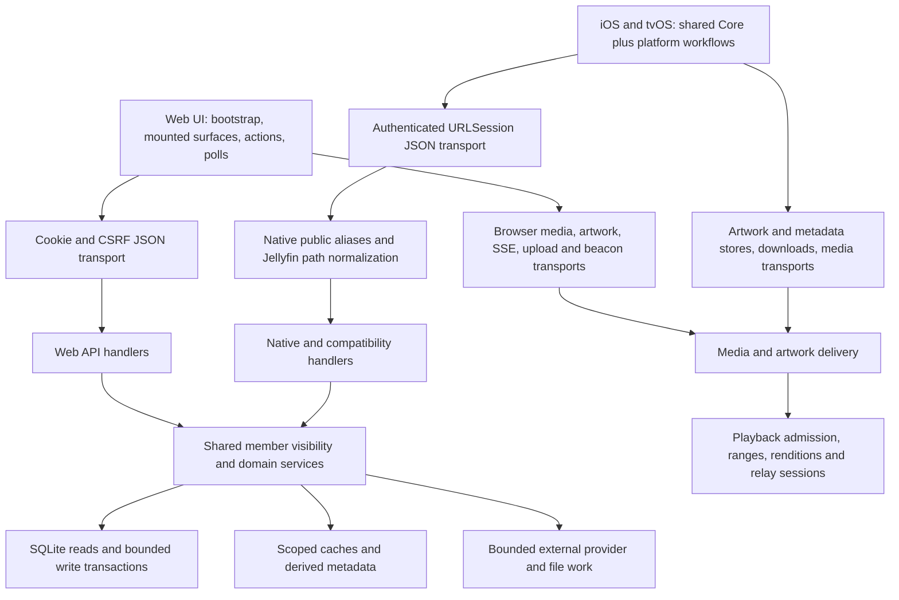

# Web, iOS and tvOS API performance audit — 2026-11-02

## Result

The largest opportunities are **reducing repeated work and choosing cheaper request shapes**, followed by improving cancellation and recovery. This audit does not justify changing database engines, increasing server concurrency, or adding a general-purpose caching layer.

The strongest initial candidates are:

1. Remove overlapping native Home loading and batch the rich Home builders.
2. Improve the actual recent-item and web Library query plans, then reconsider eager native catalog continuation.
3. Give repeated web reads cancellation/single-flight ownership and reconcile polling with the existing event channel.
4. Make anime language availability a cheap derived read and coalesce catalog-provider cache misses.
5. Add bounded read recovery and explicit mutation-outcome handling, preserving existing write ordering and idempotency.

No application behavior was changed. No production load test, household-data copy, provider benchmark, app release or server deployment was performed. Deliverables are documentation, source inventories and reproducible synthetic audit artifacts.

## Evidence and navigation

Audited application source: **`a5e9329f32b9c6f1fb91f7a42b023dcd035a9be4`**. Subsequent audit-document commits do not change that baseline. The [artifact manifest](measurements/api-audit-manifest-2026-11-02.json) records hashes for the frozen evidence.

| Deliverable | What it answers |
| --- | --- |
| [Web call map](web-api-map-2026-11-02.md) | Which web workflows call which families; startup fan-out, polling, paging, cache, abort and error behavior; direct media/SSE/beacon/upload traffic. |
| [Native call map](native-api-map-2026-11-02.md) | iOS/tvOS shared and platform-specific paths; actual query fields, request chains, metadata/artwork/offline/media ownership and compatibility aliases. |
| [Backend work map](backend-api-map-2026-11-02.md) | Route families and aliases; auth, dependencies, sessions, SQLite/writer admission, provider work, caches and resource limits; query-plan evidence. |
| [Web machine inventory](web-api-inventory-2026-11-02.json) | Exported transport call sites, path expressions, method, source line, URL builders and dynamic-path exceptions. |
| [Native machine inventory](native-api-inventory-2026-11-02.json) | Native path authorities/facades and transport handoffs, with method, platform, source and dynamic expansion limits. |
| [Backend machine inventory](backend-route-inventory-2026-11-02.json) | Registered direct and opaque-router paths, methods, handlers, dependency identities, source locations and schema visibility. |
| [Fresh measurements and reproduction](api-measurements-2026-11-02.md) | 902 successful synthetic GET observations, raw samples, response sizes, SQL counts, host qualifications and frozen drivers. |

The web inventory identifies **323 exported transport call sites**: 310 ordinary wrappers, four helpers, six symbolic paths and three path builders; it separately records 13 direct network sites and three explicit URL builders. These are source-call records, **not** 323 requests on page load or 323 distinct backend endpoints. The native inventory similarly distinguishes facade/path authorities from transport execution and OS-owned traffic.

The backend extractor finds **533 directly represented API templates / 541 method bindings**, a websocket, 13 opaque included-router mounts and a non-API mount. Inspecting the opaque native routers supplies **222 templates / 238 bindings**. These are separately registered representations: do not add the headline counts as a unique public-endpoint total. Case-insensitive native aliases, path rewriting, shared handlers, data-derived media URLs and query variants make a single undifferentiated endpoint count misleading.

This is a comprehensive **source map** of the inspected client/backend surfaces. It is not an exhaustive runtime trace of every workflow/device/provider combination. Dynamic URLs returned in playback descriptors, framework-generated HLS/range requests and branch-dependent calls have explicit authorities and limits in the companion inventories. No masked production traffic or guessed endpoint expansion is presented as observed traffic.

## Request architecture

Native-looking `/Items`, `/Users`, `/Lumina/...` and media paths are often aliases into `/jellyfin/...`, not independent services. The same SQL/domain work may be reached by multiple surfaces. Browser JSON wrappers also omit substantial traffic: media elements, image loaders, offline reads, SSE, beacons and XHR uploads need their own instrumentation bucket.

## Workflow request map

The detailed method/path lists and source references live in the companion maps. Counts below are source-derived entry shapes, not browser/device timing measurements.

| Workflow | Web | iOS / tvOS | Performance/reliability consequence |
| --- | --- | --- | --- |
| Enrollment and session | Bootstrap/session checks; username/password enrollment or login; authenticated workspace loads. Streaming taste/follows are deferred to Streaming entry. | Public server info → authentication/claim → member identity; QR approval/claim is a separate bounded exchange. | Preserve quick enrollment and the single-use pairing claim. Startup need not await optional media/provider data. |
| Authenticated startup | Two initial checks, then five workspace reads in parallel (`jobs`, `library`, `settings`, `automations`, `continue`) plus event connection and applicable app reads. | Connection refresh starts Home and Library work. Initial Home source starts layout + rich rows + recent + Resume + NextUp + navigation. | First-page fan-out and duplicate Home data can contend with artwork and catalog loading; exact device waterfalls remain unmeasured. |
| Home | Shared promises for visible arrivals/title rows; viewport-deferred shelves; special shelves add reads. | Cached presentation plus six initial JSON reads, including rich `/Lumina/Home/rows` and compatibility lists. | Reduce duplicated data, batch across shelf item IDs, retain independent/partial shelf recovery. |
| Movies, shows, anime and saved videos | Viewed wall pages initially 60 then 120; library summaries have a distinct capped API. | First catalog page 50; publish it, then serial 500-item continuation to total; `Fields=LuminaCatalog`; alphabet/filter/facet helpers. | Server paging is already bounded. Eager completion still costs bytes/work; changing it must preserve filters, alphabet jumps and scroll restoration. |
| Title, actor and episode detail | Cached title reads and bounded related/cast/season routes; hover prefetch. | Fresh or two-minute cached detail/season/related snapshots according to caller; people filters and episode reads. | Coalesce identical in-flight reads; preserve account, artwork and metadata-revision invalidation. |
| Video start, seek and progress | Item/progress preparation → playback options → admitted source/session → browser media; side reads defer behind playback. | Fresh item → PlaybackInfo, sometimes another decision → native packaging/direct/HLS source; markers/next episode and framework media reads. | Optimize control-plane RTTs only while preserving fresh playback authority, cancellation, session teardown and bounded progress reporting. |
| Streaming, recommendations and live | Discovery snapshots, interests/follows, paged search and recommendations; refresh polling, provider auth, remote session/relay/chat. | Capabilities and member completion gate → rich external rows/playback; saved library stays independent; external source fallback where unavailable. | Provider deadlines/cache misses dominate some paths; no provider timings were measured. Do not mix browser/native feature gates or treat saved media as remote extraction. |
| Requests | Catalog/detail/search/language checks plus request writes and operation status. Anime-only language annotation is conditional. | `/Lumina/Requests` facades and framing, constrained language/profile selection and request operation status. | Coarse language facts should be cheap; shared provider admission/single-flight avoids duplicate cold work. Keep durable request/outbox semantics. |
| Music | Manifest/queue/session reads, revision writes, normalization/cast state, streaming/decoded/offline delivery. | Music facades, shared session/queue, remote outputs, local/progressive/audio transport and progress. | Preserve CAS, coalescing, queue limits and streaming fallback. Measure output polling and reconnect behavior separately from audio decode. |
| Books and reading | Paged catalogs, reader metadata/pages/chapters, cover and bounded lookahead, reading-state writes. | Book facade → cover/page/content download or local reader; cover preparation retries and reader-state updates. | Honor preparation/retry hints; avoid repeated unchanged cover reads; retain byte limits, format-aware progress and cancellation. |
| Photos, jobs and imports | Paged photo/people APIs, scan/status polls, XHR imports, editing/admin work. | Any native-supported subset uses its declared facade/transport; this audit does not invent a full native photo UI. | Active import/scan contention is outside fresh timings; upload streams and polling need separate budgets. |
| Settings/admin/account | Capability/access/profile/config reads; editor requests; server/import/resource/backup/diagnostic surfaces. | Settings/capability/editor facades; explicit reauthentication and account/device boundaries. | Parallelize only independent reads; bound export buffering and long work; never retry destructive/ambiguous writes generically. |
| Background, resume and failure | Visible pollers, foreground catch-up, event reconnect; request deadlines and stale-result guards. | Task cancellation/generation guards; foreground refresh; bounded private caches and offline fallback. | Request ownership, bounded reconciliation and expiry matter as much as median latency. |

## Fresh evidence: where work is concentrated

Fixture and exact controls are in [the measurement report](api-measurements-2026-11-02.md). All 902 recorded GET observations returned 200. The host was heavily contended; workers/lifespan were disabled; this was one synthetic admin, not real concurrent household users. Times locate candidate work and must not become production promises.

| Request shape | C1 median | C6 median | SQL | Decoded body | Implication |
| --- | ---: | ---: | ---: | ---: | --- |
| Native rich Home rows | 273.9 ms | 780.9 ms | 72 | 130 KB | Aggregate shelf builders are a larger query-work target than tiny control endpoints. |
| Native actual Home Recent, 50, rich fields | 200.7 ms | 1,734.2 ms | 7 | 55 KB | Few SQL statements can still be expensive; recent ordering/count/serialization deserves a plan/profile. |
| Web Library, 50 | 89.6 ms | 733.7 ms | 6 | 40 KB | Exact page query plan uses `MULTI-INDEX OR` then a temporary order B-tree on this fixture. Not evidence of per-item query explosion. |
| Native actual projected catalog, first 50 | 16.6 ms | 62.2 ms | 6 | 22 KB | Existing light projection and first-page publication work; retain them. |
| Native actual projected continuation, 500 | 40.9 ms | 282.0 ms | 6 | 220 KB | Full-catalog draining accumulates serial requests and bytes even with efficient batches. |
| Native NextUp, 50 | 82.5 ms | 443.1 ms | 10 | 55 KB | Another initial Home component; include it in aggregate refresh budgets. |
| Web navigation | 11.7 ms | 34.2 ms | 11 | 93 B | Per-call latency is small, but repeated metadata/policy existence checks can create avoidable steady-state work. |

The general native DTO probe returned about 465 KB at limit 500. **That is not the current wall query**: the wall already requests `LuminaCatalog`, measured separately above. The web `limit=500` probe is capped at 100 and is not a 500-item response. Both distinctions prevent recommending changes already implemented or misreading a payload comparison.

The Library query-plan evidence is specifically for the seeded admin and default recent order. It is not enough to name a universal index or bypass member visibility. Inspect viewer/restricted/member and other filter/sort plans before choosing an index/query rewrite.

## Ranked improvement backlog

P1 means high-value next investigation/implementation; P2 is conditional follow-up. No P0 outage/security incident was established. Expected gains below are mechanisms, not invented percentages.

| ID / priority | Opportunity and evidence | Expected benefit | Smallest credible change / required validation |
| --- | --- | --- | --- |
| A1 / P1 | Native Home duplicate admission: layout + rich rows + four compatibility calls; rich rows alone 72 SQL. [Native map](native-api-map-2026-11-02.md), [backend map](backend-api-map-2026-11-02.md). | Less backend work, fewer competing requests, more stable first render. | Choose a single source for overlapping Home data; use compatibility calls only for missing/unsupported sections. Batch rich-row metadata/progress/artwork attachment across IDs. Prove partial failure, hidden shelves, member boundaries, navigation and refreshed progress still work. Measure whole Home request count/bytes/SQL and first usable shelf. Avoid one large all-or-nothing startup document. |
| A2 / P1 | Actual native Home Recent and web Library get disproportionately slower in bursts; Library exact plan sorts after an OR visibility plan. [Measurements](api-measurements-2026-11-02.md), backend EXPLAIN. | Lower CPU/SQL time and shorter admission queues. | Capture per-statement CPU/plans and serialization cost for real query shapes, all supported scopes. Compare an ordered/index-compatible plan or narrowly justified index. Require identical visible items, order, cursor and counts at multiple catalog sizes. Do not raise concurrency first. |
| A3 / P1 | Native catalog first-50 is followed by serial 500-page completion. [Native map](native-api-map-2026-11-02.md). | Lower navigation/refresh bytes and wasted work when users leave early. | First measure how often completion is useful. Then make continuation suspendable/demand-aware or resume its cursor instead of restarting, retaining existing first-50 publishing and query-owned snapshot. Preserve complete local filters/alphabet semantics or supply authoritative server equivalents before stopping eager completion. |
| A4 / P1 | `usePolledSnapshot` guards result publication but has no shared in-flight/abort ownership. Default deadline is 20s versus a 30s poll, so normal-tick overlap is not established; foreground/key/manual re-entry can still duplicate work. [Web map](web-api-map-2026-11-02.md). | Fewer obsolete calls, less member-switch/foreground contention. | Controller and single-flight per snapshot key; collapse redundant refresh to one trailing reconciliation; cancel on last subscriber/key change. Test a delayed request across hidden/visible, route change and account switch. Never reuse another member's result. |
| A5 / P1 | Repeated polling runs alongside `/api/events`; ordinary authenticated traffic can defer optional backfill under ADR 0020. Navigation is 11 SQL per read and polls every 30s when visible. | Lower idle load and potentially more reliable metadata/background progress. | Use existing scoped invalidations where present, plus low-frequency reconnect/foreground reconciliation. Add a short member/access-generation-aware navigation cache only if freshness rules are explicit. Measure idle request rate and time optional work is deferred; preserve immediate enforced server denial. SSE is not guaranteed delivery. |
| A6 / P1 | Anime detail can annotate languages by parsing up to 501 artifact/file facts plus a separate count. [Backend map](backend-api-map-2026-11-02.md). | Faster request opening; steadier cost for long anime series. | Persist/cache only required coarse English-audio/English-subtitle availability at ingestion/probe/classification changes. Read that snapshot on open, refresh asynchronously, retain unknown/stale state. Test imports/removals/probe replacement, mixed versions, permission changes; movies/shows must not acquire this path. No language endpoint timing was measured here. |
| A7 / P1 | Catalog TTL misses can repeat provider fan-out and instantiate a per-request executor. [Backend map](backend-api-map-2026-11-02.md). | Less provider pressure, fewer timeout/thread bursts, better degraded response. | Keyed single-flight, bounded shared admission, per-provider deadlines and explicitly stale/recoverable snapshots. Preserve provider/member/config key separation; no DB writer held across external waits. Validate concurrent miss/failure/cancel/restart with deterministic fakes and count upstream dispatches. |
| A8 / P1 | Client/server telemetry does not yet provide a joined per-surface request budget; media traffic bypasses JSON wrappers. | Lets subsequent changes target real bottlenecks and catch stability regressions. | Correlation ID plus normalized route/phase, duration/status/bytes, cache/coalesced/cancel/timeout outcomes, server SQL/write/admission wait. A bounded privacy-safe workflow capture is enough initially; no new monitoring stack is required. Never log URL tokens, cookies, search text or media names. |
| A9 / P2 | General JSON transports do not provide a bounded transient GET recovery policy. Several callers clear a surface on failure despite cached content. [Native/web maps](native-api-map-2026-11-02.md). | Better continuity through brief outages/reconnects. | Retry only explicitly safe reads, with jitter, total deadline, `Retry-After`, cancellation and current account checks. Keep auth/permission/validation failures terminal. Compare recovery and amplification during a simulated outage; avoid retry storms. |
| A10 / P2 | Loss of a mutation response can leave the client unsure whether a write committed. Existing CAS/outbox/single-use operations have differing semantics. | Fewer duplicate requests or lost latest-state intentions. | Inventory replay semantics by operation. Reuse existing durable idempotency/CAS; add explicit receipt/status reconciliation only to proven gaps. Never blanket-retry pairing claims, acquisitions, playback starts, account changes or destructive admin actions. Keep progress coalescing and Stop precedence. |
| A11 / P2 | Fresh detail → fresh item → PlaybackInfo may repeat a just-read item; side metadata can refetch on retries. [Native map](native-api-map-2026-11-02.md). | Fewer control RTTs at play without speculative media work. | First capture tap-to-source/first-frame. Reuse only a provably current revision for preparation; revalidate permissions/media at playback authority. Coalesce session-scoped markers/next-episode reads. Preserve start cancellation and release exactly once. |
| A12 / P2 | Book cover preparation and seek-index preparation use retry/poll schedules; long direct fetches have uneven deadlines. [Native/web maps](native-api-map-2026-11-02.md). | Predictable cancellation and fewer wasteful preparation requests. | Explicit preparing/terminal state, server retry hints and capped total deadlines. Preserve format/byte/redirect limits; distinguish preparation from network failure. Do not replace streaming downloads with full-buffer reads. |
| A13 / P2 | Compatible metadata responses could be privately conditionally revalidated; many read caches are lifetime/TTL based. | Fewer bytes/deserializations on unchanged returns. | Trial one stable metadata family with authenticated validators and member/revision-scoped invalidation. Keep permission enforcement fresh; never enable shared sensitive caching or cache failures as successful absence. Measure 304 rate before widening. |
| A14 / P2 | Export/media and independent speculative loaders can compete with foreground control work or buffer large bodies. [Web/native maps](web-api-map-2026-11-02.md). | Lower peak memory and fewer foreground stalls on constrained links. | Measure resource class and buffered bytes, cancel obsolete speculation using existing owners, and stream large exports where feasible. Keep art queue, offline byte ceilings and real playback admission intact; add no global coordinator until contention is observed. |

## Recommended execution order

1. **Capture + Home:** record actual web/iOS/tvOS startup/foreground traces, then A1 and the Home Recent part of A2. Establish a Home request/SQL/byte budget while preserving cache-first presentation and partial results.
2. **Catalog + query plans:** finish A2 across member scopes and scale; evaluate A3 using continuation usefulness and wasted-byte counts. Keep the first usable page fast and preserve filtering semantics.
3. **Background/read ownership:** A4/A5, with simultaneous playback, idle backfill and foreground re-entry. This connects API efficiency to the earlier missing-metadata/reliability concerns without claiming polling was the demonstrated cause of a particular missing cover.
4. **External/request work:** A6/A7, with deterministic provider failure and large-anime fixtures. Keep web request entry independent from provider warm-up.
5. **Recovery and conditional reads:** A9–A14 according to the traces. Mutations require operation-specific correctness contracts, not transport-wide retries.

These are proposed implementation packets, not changes authorized/applied by this audit.

## Baseline and acceptance matrix for follow-up work

| Scenario | Capture | Preserve / failure cases |
| --- | --- | --- |
| Cold session and warm Home return on each client | Calls, overlap, bytes, first usable shelf, SQL and route wait; cache hit/refresh separately | Login, permission-filtered vaults, stale snapshots, partial shelf failure, account switch. |
| Large wall: initial, scroll, alphabet jump, filter, leave/return | First page, continued pages, cancelled/wasted bytes, request/DTO count | Stable sort/cursor, complete search/filter semantics, zero cross-query/account leakage. |
| Title → episode → play → seek → pause/Stop | Critical JSON chain, first frame, HLS/range/index traffic separately, progress backlog | Retry/start cancellation, single player/session ownership, correct source/quality, latest position and Stop dominance. |
| Web idle, hidden/visible, native background/foreground | Per-minute calls, in-flight peak, event reconnect/reconciliation | No duplicate refresh storm or optional-backfill starvation; no hidden continuous polling. |
| Anime request, provider cold/warm/failing | Annotation SQL/JSON cost, request-open time, upstream dispatch count, deadline | Coarse language state current/unknown; no movie/show language path; member gates and durable request outcomes. |
| Writer contention and intermittent network | SQL writer wait/busy, admission wait, HTTP error/retry/ambiguous-write outcomes | No replay of unsafe writes, no silent CAS conflict, no stale progress after Stop. |
| Artwork/books/music/offline | Network versus memory/disk cache, decoded bytes, retries, memory and actual media output | Size/origin/redirect limits, generation-safe clear, format-specific state, bounded queues. |

Measure a quiet controlled baseline and a declared contention cohort. Keep LAN/WAN, browser mocks, simulator, physical devices, provider fakes and live providers separate. Set SLOs only after representative traces; N=20 diagnostic loopback samples cannot establish household capacity or p99.

## Existing protections and validation

Preserve current bounded web paging, native `LuminaCatalog` projection/first-50 publication, scoped artwork and metadata caches, four-load artwork budget, single-process/single-writer SQLite topology, native Items read admission, playback report coalescing, CAS/durable acquisition outboxes, fresh server-side authorization, guarded remote URLs, streaming byte caps, and explicit playback teardown. The companion reports cite each implementation and relevant ADR.

Checks performed for this audit:

- Fresh real-HTTP synthetic read experiments: **902/902 GET observations 200**, 22 cases, no production calls; exact queries and raw samples committed.
- Focused existing backend performance/query-budget/persistence checks: **33 passed, one failed**. The failure is `test_jellyfin_title_batch_skips_unused_artwork_loading`: its fake mapper sets `db=None`, while the current missing-collection-art fallback now calls `db.scalars`. This exposes stale test setup, not a measured production crash. The test was retained and no source/test repair was bundled into the audit.
- Focused web polling/shelf-source checks: **7 passed** across two files (web sub-audit).
- Inventory JSON parse/count checks, frozen extractor reproduction where documented, source-link checks, and `git diff --check`.
- No full suite, production RUM, native device trace, mixed real import/playback load, live provider qualification, or physical-device energy/thermal test ran.

The broader [October benchmark](comprehensive-audit-2026-10-17.md), [follow-up remediation](audit-remediation-2026-10-17.md), [native review](../../apple/docs/performance-review.md), and [native cache ADR](../adr/0034-retain-native-artwork-in-a-private-device-cache.md) remain historical evidence. Their gains and workloads are not silently relabelled as current measurements.
